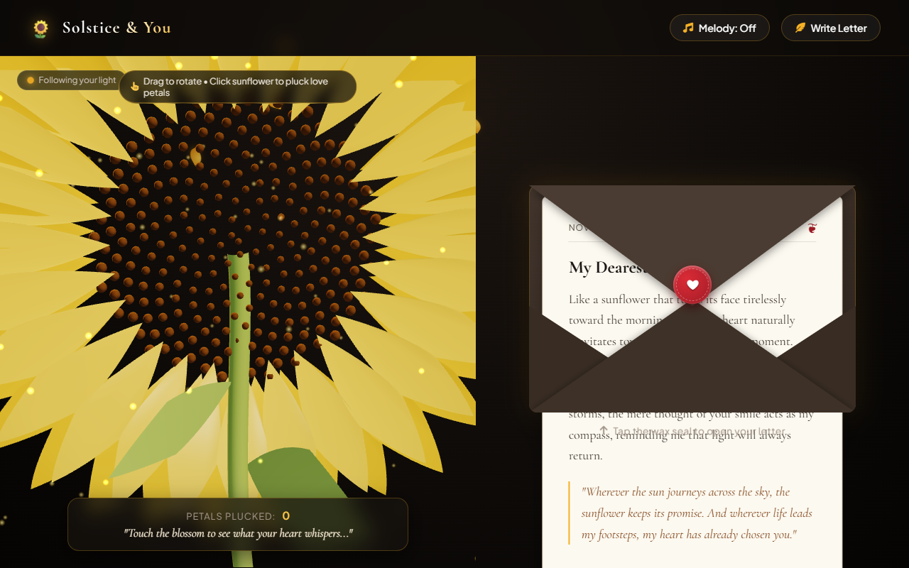

# 🌻 Solstice & You — 3D Sunflower & Romantic Love Letter

An artistic, interactive pairing of a **procedural 3D sunflower model** and a **luxury romantic love letter web experience**.

---

## 📸 Interactive Web Experience & 3D Sunflower Screenshot

<p align="center">
  
</p>

---

## 📂 Project Structure

```
sunflower-love-letter/
├── index.html              # Main romantic web application
├── style.css               # Parchment aesthetics, 3D envelope & wax seal styling
├── sunflower3d.js          # Interactive Three.js 3D sunflower with heliotropism & particle cloud
├── audio.js                # Web Audio API romantic music box and tactile SFX
├── app.js                  # Letter opening, petal oracle & customizer logic
├── generate_sunflower.py   # Procedural Blender (bpy) script with GLTF/GLB export
└── README.md
```

---

## 🎨 Part 1: Procedural Sunflower in Blender

The `generate_sunflower.py` script automatically builds a mathematical 3D sunflower inside Blender with:
* **Fibonacci Vogel Spiral Center (Phyllotaxis):** 280+ procedural floret seeds.
* **Dual Curving Petal Whorls:** 60 organic petals with subsurface scattering and golden luster.
* **Curved Stem & Bract Leaves:** Natural curving stalk with plant material shaders.
* **Golden-Hour Studio Lighting:** Key sun light, cool fill light, and golden rim light.
* **Automatic GLTF/GLB Export.**

### How to Run in Blender:

#### Option A: Inside Blender GUI
1. Open Blender.
2. Go to the **Scripting** workspace tab at the top.
3. Click **Open** and select `generate_sunflower.py`.
4. Click **Run Script** (or press `Alt + P`).
5. Your 3D sunflower will generate instantly in the 3D viewport!

#### Option B: From Command Line
```powershell
blender --background --python generate_sunflower.py -- sunflower_model.glb
```

---

## 💌 Part 2: Interactive Love Letter Web Experience

The web application blends 3D WebGL graphics and interactive storytelling:

* **Interactive 3D Sunflower Canvas:**
  * **Heliotropism:** The sunflower head gently tracks your cursor or touch, leaning towards you as its light source.
  * **Pluck a Petal Oracle:** Click the sunflower or petals in 3D to drop golden fluttering petals and reveal romantic whispers ("Loves you with all their heart...", etc.).
  * **Organic Wind Breeze:** Soft breathing sway animation with drifting golden pollen particles.
* **Realistic 3D Envelope & Wax Seal:**
  * Click the crimson wax seal to break the seal with sound effects and unfold the envelope flap.
  * The textured parchment letter slides out smoothly in 3D.
* **Procedural Music Box (Web Audio API):**
  * Toggle romantic ambient music box / celesta chords.
  * Zero external audio files required — runs 100% locally in your browser.
* **Poetic Verses & Customizer:**
  * Click **"New Verse"** for romantic poetry lines.
  * Click **"Send Love"** for a celebratory burst of floating hearts.
  * Click **"Write Letter"** to personalize the recipient, message, and sender sign-off.

### How to View the Web Page:

Simply open `index.html` in any modern web browser, or launch a quick local server:

```powershell
# In PowerShell:
cd "c:\Users\aryan\OneDrive\Documents\GitHub\sunflower-love-letter"
npx serve .
# or
python -m http.server 3000
```
Then visit `http://localhost:3000` in your browser.
